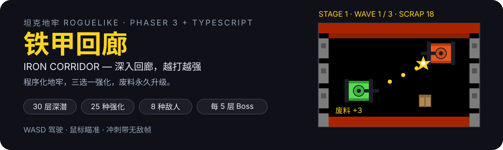
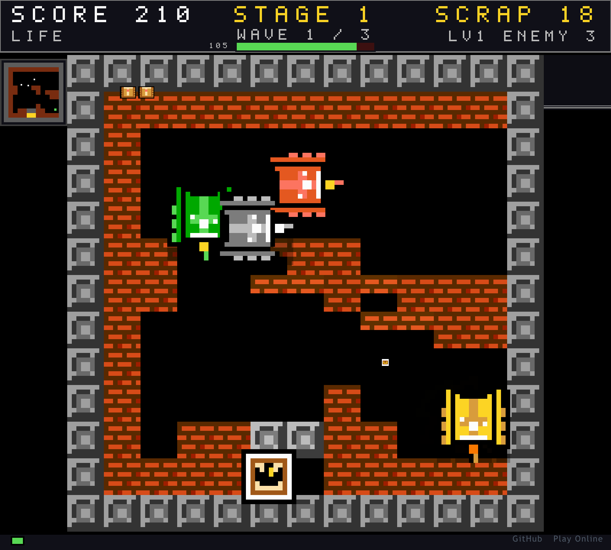
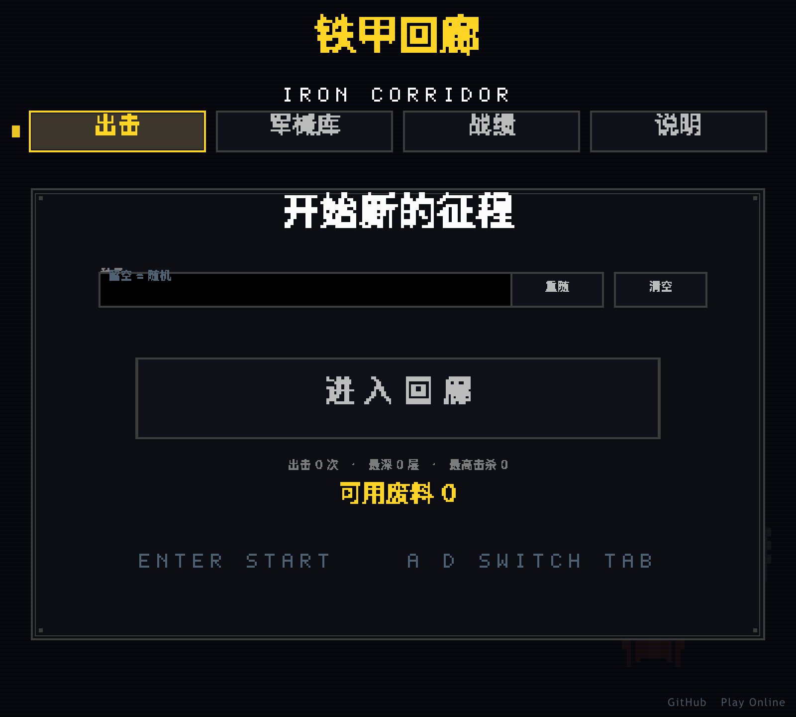

<p align="right"><a href="README.md">中文</a></p>

<p align="center">
  
</p>

<p align="center">
  <a href="https://tank-roguelike.xiaosang.cc/">▶ Play Online</a>
  ·
  <a href="https://github.com/holynova/tank-roguelike">GitHub Repository</a>
</p>

Iron Corridor is a tank dungeon roguelike: drive a tank through procedurally generated corridors, clear 3 waves per floor, then pick 1 of 3 upgrades. 30 floors deep, with the boss 「钢铁霸主」 ("Steel Overlord") every 5 floors. Death ends the run — no saves — but scrap buys permanent upgrades in the armoury. Phaser 3 + TypeScript, pixel art.

## Screenshots

<p align="center">
  
  
</p>

## How to Play

- **Drive and fire**: WASD / arrow keys to drive, mouse to aim the turret independently, click / Space to fire (hold for auto-fire).
- **Dash**: Shift / F to dash with brief invulnerability; dash count and cooldown can be upgraded.
- **Swap weapons**: mouse wheel / Q / E; Esc / P to pause.
- **Terrain**: wooden cover is destructible by shells, metal cover is not; oil zones deal damage over time.
- **Drops**: kills drop scrap, repair kits, shields, nukes and temporary weapons; walk close to pick them up automatically.

## Content

- **30 floors deep**: each floor is a randomly generated corridor with 3 waves of enemies; the boss 「钢铁霸主」 ("Steel Overlord") appears every 5 floors, evolving deeper down into 「钢铁霸主 II · 重装」 ("Steel Overlord II · Heavy") and 「终焉协议 · 泰坦」 ("Final Protocol · Titan").
- **25 upgrades**: draft 1 of 3 on level-up and on clearing a floor, stackable; four rarities — common / rare / epic / legendary (large-calibre shells, split barrels, high explosives, chain reactions…).
- **8 enemy types**: scout, gunner, brute, sniper, charger, swarm, turret and boss — each with its own speed, HP and firing pattern.
- **Armoury (permanent upgrades)**: 6 items, all bought with scrap — 复合装甲 composite armor, 强化炮管 reinforced barrel, 自动装填 auto-loader, 引擎调校 engine tuning, 战场拾荒 battlefield salvage, 应急维修 emergency repair.
- **Seeds**: enter a fixed seed from the main menu to replay the same corridors; leave it blank for a random run.

## Run Locally

```bash
npm ci
npm run dev
# Build for production
npm run build
```

## Tech

- Phaser 3.90 + TypeScript + Vite; the battlefield is a fixed 13×13 arena, with pixel art scaled by integer multiples (SCALE 6) to stay crisp.
- Rules and data are separated: `src/data/` (enemies / upgrade tables), `src/systems/` (arena generation / collision / flow-field pathfinding / run state), `src/scenes/` (menu / battle / draft / results).
- Pixel fonts and Chinese text rendering are custom (`src/ui/PixelText.ts`, `PixelCjk.ts`); art and audio from Kenney.

```
index.html            Entry (800×720 canvas)
src/main.ts           Phaser startup
src/scenes/           Menu / Game / Draft / GameOver / Boot
src/systems/          RunState / arena / collision / flowfield
src/entities/         Player / Enemy / Bullet / Pickup
src/data/             enemies / upgrades / fontMap
src/core/             constants / rng / meta / audio
tools/                Sprite and font generation scripts
```
