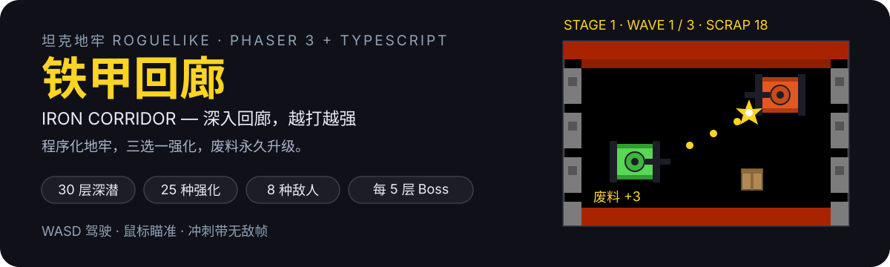
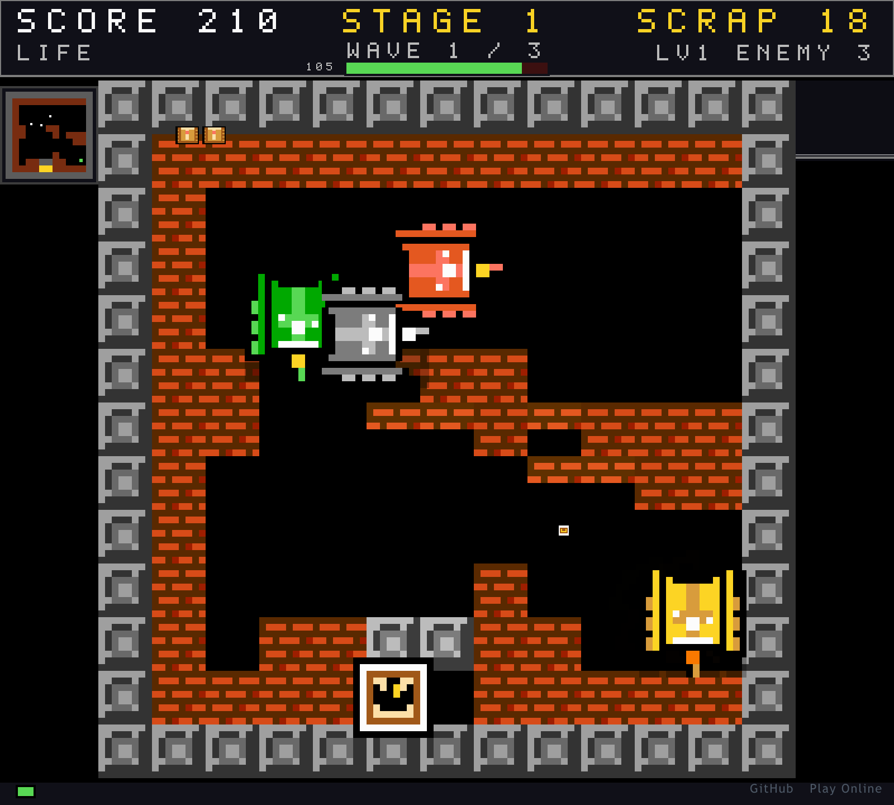
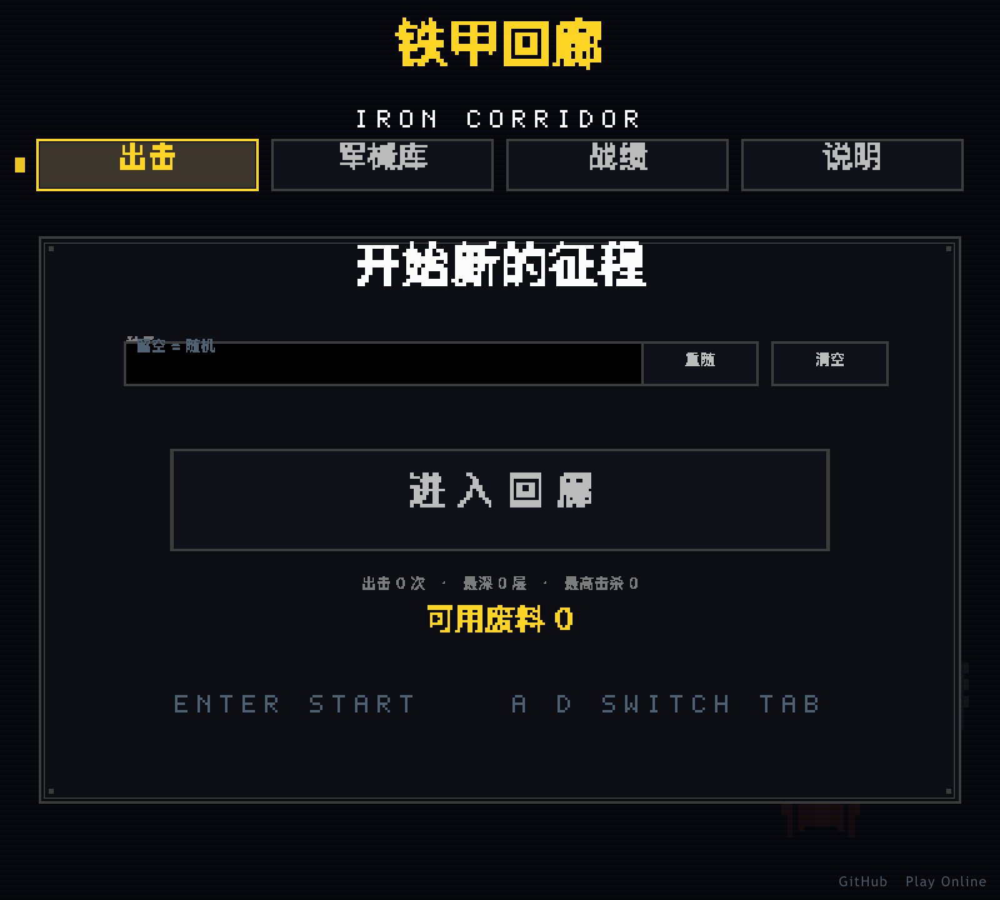

<p align="right"><a href="README.en.md">English</a></p>

<p align="center">
  
</p>

<p align="center">
  <a href="https://tank-roguelike.xiaosang.cc/">▶ 在线玩</a>
  ·
  <a href="https://github.com/holynova/tank-roguelike">GitHub 仓库</a>
</p>

铁甲回廊是一款坦克地牢 Roguelike：驾驶坦克深入程序化生成的回廊，每层清掉 3 波敌军后三选一强化，30 层深潜，每 5 层遭遇 Boss「钢铁霸主」。坦克被击毁即本局结束，没有读档；攒下的废料可以在军械库换永久升级，越打越强。Phaser 3 + TypeScript，像素风。

## 截图

<p align="center">
  
  
</p>

## 玩法

- **驾驶与开火**：WASD / 方向键驾驶，鼠标独立瞄准炮塔，左键 / 空格开火（可按住连射）。
- **冲刺**：Shift / F 冲刺，带短暂无敌帧；可叠加冲刺次数与冷却强化。
- **切换武器**：滚轮 / Q / E 切换武器；Esc / P 暂停。
- **地形**：木制掩体可被炮弹摧毁，金属掩体不可摧毁；油桶区会持续造成伤害。
- **掉落**：击杀掉落废料、修复包、护盾、原子弹与临时武器，靠近自动吸取。

## 内容

- **30 层深潜**：每层随机生成回廊与 3 波敌军；每 5 层出现 Boss「钢铁霸主」，深层还会进化出「钢铁霸主 II · 重装」与「终焉协议 · 泰坦」。
- **25 种强化**：升级与通关都给三选一，可叠加；分普通 / 稀有 / 史诗 / 传说四档稀有度（大口径炮弹、分裂炮管、高爆弹、连锁反应……）。
- **8 种敌人**：侦察兵、炮手、重装、狙击手、冲锋者、蜂群、炮台与 Boss，各有速度、血量与射击方式。
- **军械库（永久升级）**：6 项，全部用废料购买——复合装甲、强化炮管、自动装填、引擎调校、战场拾荒、应急维修。
- **种子**：主菜单可输入固定种子，同一回廊可重复挑战；留空即随机。

## 本地运行

```bash
npm ci
npm run dev
# 生成生产产物
npm run build
```

## 技术

- Phaser 3.90 + TypeScript + Vite；战场是 13×13 格的固定竞技场，像素美术按整数倍缩放（SCALE 6）保持锐利。
- 规则与数据分离：`src/data/`（敌人 / 强化表）、`src/systems/`（竞技场生成 / 碰撞 / 流场寻路 / 局内状态）、`src/scenes/`（菜单 / 对战 / 三选一 / 结算）。
- 像素字体与中文渲染自研（`src/ui/PixelText.ts`、`PixelCjk.ts`）；音效与素材来自 Kenney。

```
index.html            入口（800×720 画布）
src/main.ts           Phaser 启动
src/scenes/           Menu / Game / Draft / GameOver / Boot
src/systems/          RunState / arena / collision / flowfield
src/entities/         Player / Enemy / Bullet / Pickup
src/data/             enemies / upgrades / fontMap
src/core/             constants / rng / meta / audio
tools/                精灵与字体生成脚本
```
